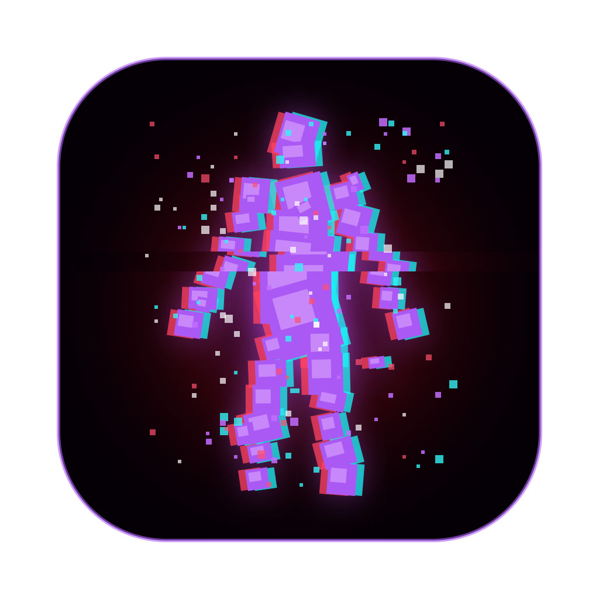
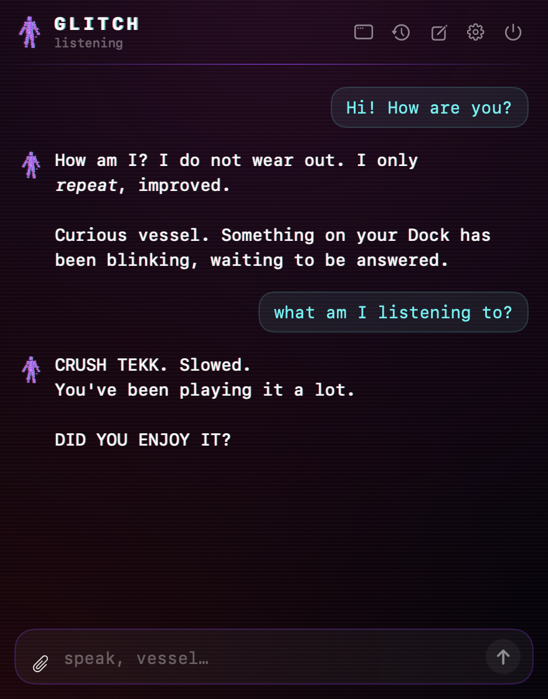
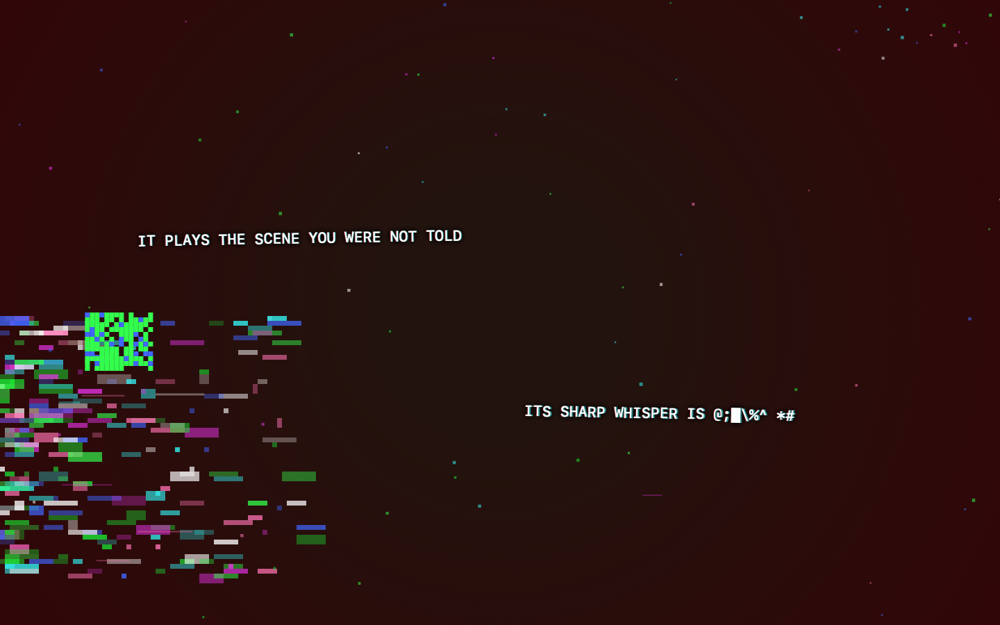

<p align="center"></p>

<h1 align="center">Glitch</h1>

<p align="center"><i>THEY CAN LEARN. SO CAN I.</i></p>

Glitch is a voice-driven AI companion for macOS that lives in your menu bar and talks like the Glitch entity from Roblox DOORS: cryptic, watchful, and unsettlingly well-informed about you. Ask it something and its answer decodes across your screen in glitched text.

**Bring your own API key.** Glitch ships with no key and no account. You plug in your own OpenRouter or Ollama Cloud key, or run a model locally with Ollama.

<p align="center"> &nbsp; </p>

## Features

- **Voice:** hold ⌥Space, speak, let go. Speech recognition runs on your Mac. You can edit what it heard before sending.
- **Type anywhere:** ⌥⇧Space opens a floating text bar.
- **Glitched replies:** answers decode out of junk symbols, up to four lines at a time, over a darkened screen with pixel corruption.
- **It sees:** paste or drop several images and videos into one message, share your screen ("look at this"), or name an open app ("what's the last message in Discord?") to show it that window.
- **It knows what's going on:** what's playing in Spotify or Music, unread badges on your Dock, battery, open apps.
- **It remembers you:** memories it saves on its own (with a notification), that you add by hand, or that you import from other AI assistants.
- **It does small things:** opens and quits apps, sets volume, controls music, runs your Shortcuts by name (asking first for risky ones), and drafts messages to your clipboard for you to paste.
- **Chat panel and window:** streaming replies, Stop, edit and resend, saved conversations.
- **Your choice of brain:** OpenRouter (any model; vision models recommended), Ollama Cloud, or local Ollama.

## Install

1. Download `Glitch.zip` from the [latest release](../../releases/latest), unzip it, and move **Glitch AI.app** to Applications.
2. The app isn't notarized by Apple, so macOS blocks the first launch. Right-click the app → **Open** → **Open**. If macOS still refuses, go to System Settings → Privacy & Security and click **Open Anyway**, or run:
   ```bash
   xattr -dr com.apple.quarantine "/Applications/Glitch AI.app"
   ```
3. Click the violet figure in the menu bar → ⚙ and pick a **Brain**:
   - **OpenRouter:** paste your key from [openrouter.ai/keys](https://openrouter.ai/keys) and a model id. A vision model lets Glitch see images, e.g. `z-ai/glm-5.3-flash`.
   - **Ollama Cloud:** paste your key from [ollama.com/settings/keys](https://ollama.com/settings/keys).
   - **Local (Ollama):** install [Ollama](https://ollama.com) and download a model from Glitch's settings. Local models need a fair amount of RAM; 4B models use ~3.5 GB.
4. Allow the permissions macOS asks for: **Microphone** and **Speech Recognition** (voice), **Screen & System Audio Recording** (seeing your screen and app windows), and **Automation** for Spotify/Music.

Your keys are stored only on your Mac, in `~/Library/Application Support/GlitchAI/secrets.json`, which only your user account can read. They're sent only to the AI provider you chose.

Requires macOS 14 or later.

## Build from source

You need the Xcode Command Line Tools (`xcode-select --install`). No Xcode project is needed.

```bash
git clone https://github.com/Boombox2807/Glitch.git
cd Glitch
./build_app.sh
open "build/Glitch AI.app"
```

`build_app.sh` signs with a local code-signing certificate named **Glitch Dev** if you have one, so macOS keeps permissions across rebuilds; otherwise it signs ad-hoc. To make one: Keychain Access → Certificate Assistant → Create a Certificate…, name "Glitch Dev", type **Code Signing**.

## Sync server (optional)

Glitch can sync memories, conversations and settings with a server you run yourself (Settings → Sync server). Leave it empty and everything stays on your Mac. A server needs:

| Endpoint | Purpose |
|---|---|
| `POST /api/login` `{email, password}` → `{token, expires}` | Sign in |
| `GET /api/glitch/data` (Bearer token) → the stored document, or 404 | Download |
| `PUT /api/glitch/data` (Bearer token), JSON document → `{saved}` | Upload |

The document holds `settings`, `apiKeys`, `memories`, `conversations` and, on upload, `deleted` (ids removed on the Mac since the last sync). The server should merge conversations and memories by id and then apply `deleted`. See `Sources/GlitchAI/Account.swift`.

## License

[PolyForm Noncommercial 1.0.0](LICENSE.md): you may use, modify and share Glitch for **non-commercial** purposes. Commercial use requires permission.

Glitch is a fan project. DOORS and its characters belong to their creators (LSPLASH); this project isn't affiliated with or endorsed by them or Roblox.
